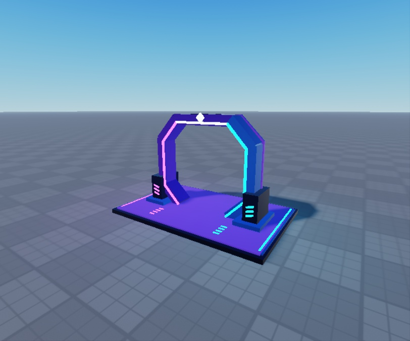

# CAR-23 · Primeiro teste visual de escrita no Roblox Studio

**Data:** 22/11/2026  
**Status:** portal criado e salvo localmente, **aprovado visualmente pelo usuário**; playtest em modo Play e abertura do backup ainda pendentes.  
**Escopo autorizado:** CAR-23. [Tarefa no Linear](https://linear.app/carloszucchi/issue/CAR-23/salvar-backup-do-place1-e-validar-escrita-mcp-reversivel)

## Backup antes da edição

O Place1 original foi salvo em `Place1.rbxl` pelo Studio em formato local. Antes de criar qualquer objeto, foi feita uma cópia separada chamada `Place1-backup-pre-CAR-23.rbxl`. O tamanho conferido foi de **89.031 bytes**. O arquivo e a cópia tinham SHA-256 idêntico, e o cabeçalho e o final do formato binário RBXL foram verificados.

`SHA-256 68FCB6284FB2F126929EEDEE9E7949D826D629F230E64F78BFE6EA65F168BF1A`

A cópia de segurança foi mantida em separado. A abertura da cópia em outra sessão do Studio não foi testada. O arquivo de trabalho `Place1.rbxl` foi salvo novamente pelo MCP depois da verificação visual.

## O que foi criado

O MCP `Roblox_Studio` criou um único Model em `Workspace.MCP_Demo_Temporaria`, em modo de edição. O portal usa peças nativas, com uma moldura poligonal azul e roxa, plataforma baixa, neon ciano e violeta e luzes locais. A frente está voltada para o spawn.

| Grupo | Conteúdo verificado |
|---|---|
| `Plataforma` | 4 peças. Apenas `Piso` e `DeckSuperior` têm colisão. |
| `Estrutura` | 19 peças, com moldura, aro traseiro, apoios e crista. Duas PointLights ficam nos apoios. |
| `DetalhesNeon` | 24 peças de neon, incluindo o contorno, as luzes do piso e o losango central. |

**Total:** 47 Parts ancoradas, 2 PointLights e 3 pastas. Materiais confirmados pelo MCP: 22 Metal, 24 Neon e 1 SmoothPlastic. Cores amostradas: azul `#2B56A9`, roxo `#533097`, ciano `#3CE0FF` e violeta `#BC68FF`. As duas luzes têm alcance de 10 studs e intensidade aproximada de 1,15.

O pivô fica em **X 24, Y 0,17, Z 0**, a 24 studs do spawn na direção **+X**. O ponto mais próximo do modelo fica em **X 19,5**. A borda do spawn nesse eixo está em **X 6**, deixando **13,5 studs** livres entre a borda e o portal. A comparação antes e depois confirmou as posições, dimensões, ancoragem e colisão originais de `Baseplate` e `SpawnLocation`.

## Verificação visual

Selecione **Explorador → Workspace → MCP_Demo_Temporaria** e pressione **F** para enquadrar o portal. A captura abaixo foi feita no viewport do próprio Studio em modo de edição. A abertura central ficou livre. A verificação de colisão foi feita por inspeção de propriedades no MCP. O avatar não foi testado em modo Play.

## Próxima decisão

O usuário avaliou o portal pelo print e achou o visual futurista muito bom. **Preservar o portal no projeto.** Todos os objetos criados pertencem ao Model, de modo que sua remoção futura pode ser feita somente nesse grupo após autorização. A tarefa segue em andamento enquanto o playtest e a possibilidade de restaurar o backup não forem verificados. O teste foi decorativo, sem scripts no projeto, gameplay, Blender ou publicação. A CAR-24 depende de nova autorização.

A documentação oficial do Roblox foi a referência principal. A sessão também consultou a documentação do Creator Hub pelo Context7 para confirmar `Anchored`, `CanCollide`, `CanTouch` e `CanQuery`. [Arquivos de lugar](https://create.roblox.com/docs/pt-br/projects/place-files) · [BasePart](https://create.roblox.com/docs/reference/engine/classes/BasePart) · [PointLight](https://create.roblox.com/docs/reference/engine/classes/PointLight)

## Feedback posterior — 22/11/2026

O usuário aprovou o **visual futurista** do portal após vê-lo em imagem e pediu que seja preservado. Em seguida, autorizou um **teste isolado de ragdoll R15** antes da construção da arena completa. A instrução atual para esse teste está no [prompt de ragdoll isolado](../prompts/teste-ragdoll-r15-isolado.md). O teste isolado foi executado posteriormente e confirmou a presença do portal em Play. [Relatório e captura da CAR-25](CAR-25_TESTE_RAGDOLL_R15.md). Não remover `MCP_Demo_Temporaria` nem avançar à CAR-24 por conta própria.
