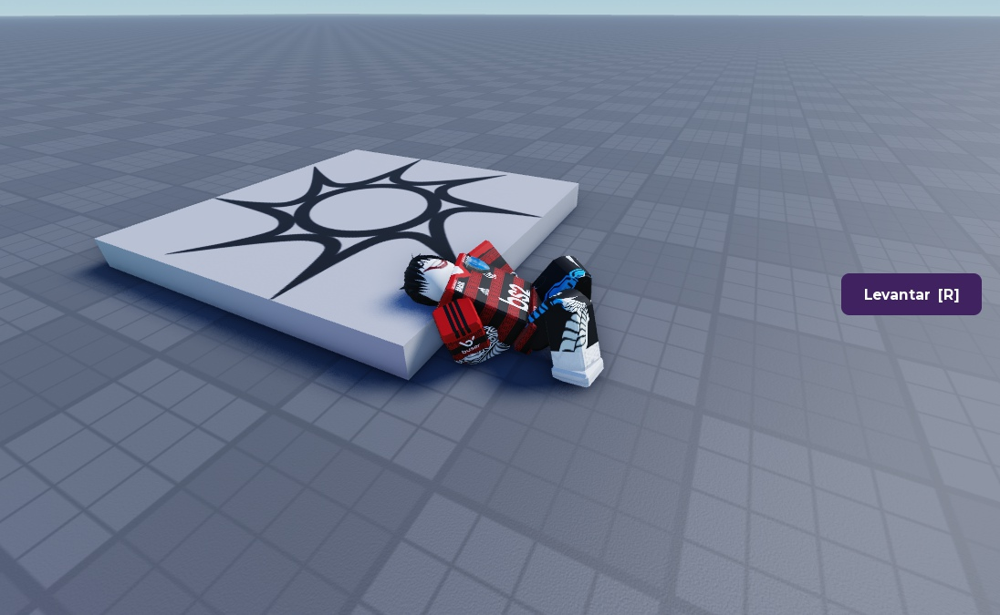

# CAR-25 · Teste isolado de ragdoll R15

**Data:** 22/11/2026  
**Estado:** implementado, testado em Play solo, salvo no Place1 local e **aprovado pelo usuário após teste manual em 22/11/2026**. O escopo completo de multiplayer/toque continua sem validação.

## Backup e escopo

O backup `Place1-backup-com-portal-pre-CAR-25.rbxl` foi feito antes da edição, depois de o Studio confirmar que o arquivo de trabalho estava salvo. A cópia tem 93.377 bytes, assinatura RBXL válida e SHA-256 idêntico ao Place1 pré-teste. A reabertura da cópia em outra sessão do Studio não foi testada.

`SHA-256 6D041701B0F610A5413A04B749D7346DB568782D9B66017F2CAB805A63092501`

O Model `Workspace.MCP_Demo_Temporaria` ficou preservado, com 47 Parts ancoradas, 2 PointLights, colisão em 2 peças e pivô em (24, 0,17, 0). Baseplate e SpawnLocation mantiveram posição e dimensões. O trabalho está salvo no arquivo local `Place1.rbxl`. Escopo: ragdoll e controles mínimos, com o mapa atual.

## O que foi criado

| Instância | Função |
|---|---|
| `ServerScriptService.RagdollR15TesteServidor` | Valida remetente, personagem atual, rig e estado, aceita apenas o valor booleano esperado e limita pedidos a um por 0,25 s por jogador. |
| `StarterPlayer.StarterPlayerScripts.RagdollR15TesteCliente` | Controla a tecla R e cria o botão Ragdoll/Levantar. |
| `ReplicatedStorage.RagdollR15TesteRequest` | RemoteEvent criado somente em execução. |
| `PlayerGui.RagdollR15TesteGui.AlternarRagdoll` | Botão de teste, criado somente em execução, com suporte de código para mouse e toque via Activated. |
| `Character.RagdollR15TesteColisores` | Pasta criada só enquanto o personagem está em ragdoll, com colisores invisíveis ligados às partes do corpo. |

O avatar observado em Play era R15, com 15 AnimationConstraints e 14 BallSocketConstraints nativas. O código preserva a junta da raiz e a câmera padrão. Durante a queda, desativa as 14 juntas de animação que já têm articulação física nativa correspondente. Ao levantar, restaura juntas, rotação automática, estado e grupos de colisão. Em solo, usa um raycast para ajustar a altura. No ar, preserva a velocidade linear e evita encaixar o avatar num piso distante.

O teste atual pressupõe o R15 com as juntas nativas observadas. Um rig incompatível não entra em ragdoll. A limpeza de conexões foi revisada no código. O teste de 20 ciclos verifica instâncias e comportamento observável.

[Servidor](../src/server/RagdollR15TesteServidor.server.luau) · [Cliente](../src/client/RagdollR15TesteCliente.client.luau) · [AnimationConstraint](https://create.roblox.com/docs/reference/engine/classes/AnimationConstraint) · [Validação cliente-servidor](https://create.roblox.com/docs/scripting/security/client-server-boundary)

## Playtests no Studio

| Cenário | Evidência |
|---|---|
| Teclado e mouse | A tecla R ativou a física e o botão Levantar retornou ao estado Running, com a raiz em pé. |
| 20 ciclos, versão final | Em Play solo, os pedidos passaram pelo RemoteEvent real. Saúde permaneceu 100, o Humanoid continuou como CameraSubject e ficaram 31 Constraints ao fim de cada ciclo, incluindo 14 BallSocketConstraints. Os 13 colisores temporários apareceram durante cada queda e foram limpos ao levantar. |
| Colisão com o piso | Sem os colisores, mãos e pés atravessaram a Baseplate. Com o ajuste, os centros observados de cabeça, mãos e pés ficaram acima de Y=0, entre 0,32 e 0,47 studs no teste em piso plano. |
| Recuperação no ar | Com posicionamento controlado no servidor durante Play, o avatar levantou a Y=7,80, ainda com velocidade vertical de −3,09 studs/s. |
| Reset com ragdoll ativo | Foi simulada a morte no servidor ao zerar a saúde em Play. O avatar anterior saiu, o novo nasceu R15 com saúde 100 e sem colisores ou atributo ativo. O menu de reset é um teste manual separado. |
| Movimento após respawn | A tecla W deslocou o avatar 14,4 studs e o foco da câmera acompanhou o deslocamento. |
| Validação do servidor | Em Play solo, um pedido com a Baseplate no lugar do personagem foi rejeitado sem ativar o estado. |
| Output | O console retornou 3 avisos de tipo incompatível para o asset 203785492. Esse ID não consta nas duas fontes do teste. A origem do aviso não foi confirmada. Nenhum erro dos scripts do ragdoll apareceu no Output observado. Uma sonda anterior que reposicionava o avatar só no cliente foi inconclusiva e foi substituída pelo teste no servidor. |
| Fontes | StyLua rodou com `--verify` e `--check`. As fontes no Studio foram comparadas com as que seguem neste commit. |

Sem validação nesta rodada: toque em aparelho ou simulador, multiplayer e reabertura do backup. O portal foi observado em Play, mas não houve um playtest dedicado à travessia.

## Como testar e reverter

1. No Place1 aberto, clique em **Play** ou pressione **F5**. Ande alguns passos para sair da placa de spawn.
2. Pressione **R** ou clique em **Ragdoll** na lateral direita. Pressione **R** novamente ou clique em **Levantar** e ande.
3. Para o reset manual, ative o ragdoll e use **Esc → Reiniciar personagem** no menu do Roblox. Depois de renascer, teste novamente o movimento e o botão.
4. Use **Stop** ou **Shift+F5** para encerrar o Play. Para reverter o teste, em modo de edição remova apenas os dois scripts nomeados acima. O botão, o RemoteEvent e os colisores existem só em Play. O portal fica no Workspace.

O usuário informou que executou o teste manual e **aprovou** o ragdoll R15 em 22/11/2026. A fase de experimentos iniciais está encerrada a pedido dele; isso não dispensa testes de qualidade das próximas funcionalidades. A implementação de novas mecânicas ainda depende de autorização. [Registro formal da aprovação](APROVACAO_TESTES_INICIAIS_2026-11-22.md).
